# EnerSense Complete Hardware Wiring & Connection Guide

This document provides the full, up-to-date pinout and wiring reference for the complete **EnerSense Dual-Channel Smart Energy Monitoring System**, consisting of:
- **1x ESP32 NodeMCU / DevKit**
- **1x 2-Channel 5V Relay Module** (Active-LOW)
- **2x PZEM-004T v3.0 AC Energy Metering Modules**
- **2x Current Transformer (CT) Coils**
- **2x AC Loads / Bulb Holders** (Smart AC & OLED TV channels)
- **1x AC Wall Power Input (220V/110V)**

---

## ⚠️ Safety Precautions
> [!CAUTION]
> **Live AC Mains Voltage (110V / 230V) is dangerous.**
> - Always disconnect the main AC plug from the wall outlet before touching, adjusting, or rewiring any connections.
> - Ensure all high-voltage screw terminals and wire splices are insulated with heat shrink or electrical tape.
> - Keep low-voltage DC logic wires physically separated from live AC mains wires.

---

## 1. Low-Voltage DC Connections (ESP32 Side)

### A. Power Rails (5V & GND)
* **ESP32 `VIN` (5V)**: Supplies power to the relay module and both PZEM logic boards.
  * Spliced / connected to **Relay `VCC`**, **PZEM 1 `5V`**, and **PZEM 2 `5V`**.
* **ESP32 `GND`**:
  * You can use the multiple physical `GND` pins on the ESP32 board directly:
    * **ESP32 `GND` (Pin 1)** ➡️ **Relay `GND`**
    * **ESP32 `GND` (Pin 2)** ➡️ **PZEM 1 `GND`**
    * **ESP32 `GND` (Pin 3 or spliced)** ➡️ **PZEM 2 `GND`**

> [!IMPORTANT]
> **Polarity Check on PZEM modules**: Verify that the wire marked `5V` goes to `5V` on the PZEM, and `GND` goes to `GND`. Reversing `5V` and `GND` will prevent communication and may damage optocouplers.

---

### B. Relay Control Pins (GPIO)
* **ESP32 `Pin 26` (D26)** ➡️ **Relay Module `IN1`** (Controls Appliance 1 / Smart AC)
* **ESP32 `Pin 27` (D27)** ➡️ **Relay Module `IN2`** (Controls Appliance 2 / OLED TV)
* *Relays are Active-LOW (`LOW` = ON, `HIGH` = OFF).*

---

### C. PZEM Communication (Dual Hardware Serial Ports)
To prevent bus contention and avoid Modbus address collisions, each PZEM sensor uses its own dedicated Hardware Serial port:

#### PZEM 1 (Serial2)
* **ESP32 `Pin 16` (`RX2`)** ➡️ **PZEM 1 `TX`**
* **ESP32 `Pin 17` (`TX2`)** ➡️ **PZEM 1 `RX`**

#### PZEM 2 (Serial1)
* **ESP32 `Pin 18` (`D18`)** ➡️ **PZEM 2 `TX`**
* **ESP32 `Pin 19` (`D19`)** ➡️ **PZEM 2 `RX`**

*(Do **NOT** use Pins 1 (`TX0`) or 3 (`RX0`), as those are reserved for the ESP32 USB connection).*

---

### D. Status LED
* **ESP32 `Pin 2` (`D2`)**: Onboard blue LED used as an automatic status monitor:
  * **Fast Blink (200 ms)**: Connecting to WiFi.
  * **Slow Blink (1 s)**: WiFi connected, attempting to connect to MQTT broker.
  * **Solid Blue**: Normal operation (WiFi + MQTT active).
  * **Brief Wink (Off for 50 ms)**: Telemetry published or command received.
  * **Rapid 3-Pulse Flicker**: Error reading sensor data from PZEM 1 or PZEM 2.

---

## 2. High-Voltage AC Connections (Mains & Loads)

### A. AC Mains Wall Feed Splitting
Power enters from a single AC plug (Live & Neutral):
* **Main Wall Live (L)** splits into **2 branches**:
  * **Branch 1**: Feeds **PZEM 1 `L`** screw terminal AND **Relay 1 `COM`** terminal.
  * **Branch 2**: Feeds **PZEM 2 `L`** screw terminal AND **Relay 2 `COM`** terminal.
* **Main Wall Neutral (N)** splits into:
  * **PZEM 1 `N`** screw terminal
  * **PZEM 2 `N`** screw terminal
  * **Bulb 1 Neutral wire**
  * **Bulb 2 Neutral wire**

---

### B. Switched Load Control & Current Sensing (CT Coils)

#### Appliance 1 Circuit (Bulb Holder 1):
1. **Relay 1 `NO` (Normally Open)** terminal connects to the **Live wire of Bulb Holder 1**.
2. **Current Transformer (CT 1)**:
   * Pass **ONLY** the Live wire between Relay 1 `NO` and Bulb 1 through the center opening of the round CT 1 coil.
   * Attach the two small leads of CT 1 to the small black CT screw terminals on **PZEM 1**.
3. **Bulb 1 Neutral wire** connects directly to the shared Wall Neutral line.

#### Appliance 2 Circuit (Bulb Holder 2):
1. **Relay 2 `NO` (Normally Open)** terminal connects to the **Live wire of Bulb Holder 2**.
2. **Current Transformer (CT 2)**:
   * Pass **ONLY** the Live wire between Relay 2 `NO` and Bulb 2 through the center opening of the round CT 2 coil.
   * Attach the two small leads of CT 2 to the small black CT screw terminals on **PZEM 2**.
3. **Bulb 2 Neutral wire** connects directly to the shared Wall Neutral line.

> [!WARNING]
> Do NOT pass both the Live and Neutral wires through the same CT coil hole. If both pass through together, their magnetic fields cancel out and the power reading will stay at `0.0 W`.

---

## 3. Quick Connection Reference Table

| Device | Device Pin / Terminal | ESP32 Pin / Destination | Notes |
| :--- | :--- | :--- | :--- |
| **Relay Module** | `VCC` | ESP32 `VIN` (5V) | Shared 5V rail |
| | `GND` | ESP32 `GND` | Low-voltage ground |
| | `IN1` | ESP32 `GPIO 26` | Active-LOW trigger for Appliance 1 |
| | `IN2` | ESP32 `GPIO 27` | Active-LOW trigger for Appliance 2 |
| | `COM 1` | AC Mains Live (L) | Power input for Appliance 1 |
| | `NO 1` | Bulb 1 Live Wire | Passes through CT 1 coil hole |
| | `COM 2` | AC Mains Live (L) | Power input for Appliance 2 |
| | `NO 2` | Bulb 2 Live Wire | Passes through CT 2 coil hole |
| **PZEM 1** | `5V` | ESP32 `VIN` (5V) | Logic power |
| | `GND` | ESP32 `GND` | Logic ground |
| | `TX` | ESP32 `GPIO 16` (`RX2`) | Hardware Serial2 RX |
| | `RX` | ESP32 `GPIO 17` (`TX2`) | Hardware Serial2 TX |
| | `L` (Screw) | AC Mains Live (L) | Voltage sensing & internal IC power |
| | `N` (Screw) | AC Mains Neutral (N) | Voltage sensing & internal IC power |
| | `CT` Terminals | 2 small wires of CT 1 | Measures current for Appliance 1 |
| **PZEM 2** | `5V` | ESP32 `VIN` (5V) | Logic power |
| | `GND` | ESP32 `GND` | Logic ground |
| | `TX` | ESP32 `GPIO 18` (`D18`) | Hardware Serial1 RX |
| | `RX` | ESP32 `GPIO 19` (`D19`) | Hardware Serial1 TX |
| | `L` (Screw) | AC Mains Live (L) | Voltage sensing & internal IC power |
| | `N` (Screw) | AC Mains Neutral (N) | Voltage sensing & internal IC power |
| | `CT` Terminals | 2 small wires of CT 2 | Measures current for Appliance 2 |

---

## 4. System Circuit Diagram

```mermaid
graph TD
    classDef danger fill:#fee2e2,stroke:#ef4444,stroke-width:2px,color:#991b1b;
    classDef safe fill:#dbeafe,stroke:#3b82f6,stroke-width:2px,color:#1e40af;
    classDef load fill:#fef3c7,stroke:#f59e0b,stroke-width:2px,color:#92400e;

    subgraph AC_MAINS ["⚡ Single AC Wall Feed (230V / 110V)"]
        LiveLine["Main Live (L)"]:::danger
        NeutralLine["Main Neutral (N)"]:::danger
    end

    subgraph ESP32_BOARD ["🧠 ESP32 Controller"]
        ESP_5V["VIN (5V)"]:::safe
        ESP_GND1["GND 1"]:::safe
        ESP_GND2["GND 2"]:::safe
        ESP_D26["GPIO 26"]:::safe
        ESP_D27["GPIO 27"]:::safe
        ESP_RX2["GPIO 16 (RX2)"]:::safe
        ESP_TX2["GPIO 17 (TX2)"]:::safe
        ESP_RX1["GPIO 18 (D18)"]:::safe
        ESP_TX1["GPIO 19 (D19)"]:::safe
        ESP_LED["GPIO 2 (LED)"]:::safe
    end

    subgraph RELAYS ["🔌 2-Channel Relay Module"]
        R_VCC["VCC"]:::safe
        R_GND["GND"]:::safe
        R_IN1["IN1"]:::safe
        R_IN2["IN2"]:::safe
        R1_COM["COM 1"]:::danger
        R1_NO["NO 1"]:::danger
        R2_COM["COM 2"]:::danger
        R2_NO["NO 2"]:::danger
    end

    subgraph PZEM_1 ["📊 PZEM 1 (Appliance 1)"]
        P1_5V["5V"]:::safe
        P1_GND["GND"]:::safe
        P1_TX["TX"]:::safe
        P1_RX["RX"]:::safe
        P1_L["L Terminal"]:::danger
        P1_N["N Terminal"]:::danger
        P1_CT["CT Screw Ports"]:::safe
    end

    subgraph PZEM_2 ["📊 PZEM 2 (Appliance 2)"]
        P2_5V["5V"]:::safe
        P2_GND["GND"]:::safe
        P2_TX["TX"]:::safe
        P2_RX["RX"]:::safe
        P2_L["L Terminal"]:::danger
        P2_N["N Terminal"]:::danger
        P2_CT["CT Screw Ports"]:::safe
    end

    subgraph LOADS ["💡 Appliances"]
        Bulb1_Live["Bulb 1 Live"]:::danger
        Bulb1_Neutral["Bulb 1 Neutral"]:::danger
        CT1_Coil["⭕ CT 1 Loop"]:::safe
        Bulb2_Live["Bulb 2 Live"]:::danger
        Bulb2_Neutral["Bulb 2 Neutral"]:::danger
        CT2_Coil["⭕ CT 2 Loop"]:::safe
    end

    %% Low Voltage Power & Ground
    ESP_5V --> R_VCC
    ESP_5V --> P1_5V
    ESP_5V --> P2_5V
    ESP_GND1 --> R_GND
    ESP_GND2 --> P1_GND
    ESP_GND2 --> P2_GND

    %% Relay Logic Control
    ESP_D26 --> R_IN1
    ESP_D27 --> R_IN2

    %% Serial Communications
    ESP_RX2 --> P1_TX
    ESP_TX2 --> P1_RX
    ESP_RX1 --> P2_TX
    ESP_TX1 --> P2_RX

    %% AC High Voltage Distribution
    LiveLine === R1_COM
    LiveLine === R2_COM
    LiveLine === P1_L
    LiveLine === P2_L

    NeutralLine === P1_N
    NeutralLine === P2_N
    NeutralLine === Bulb1_Neutral
    NeutralLine === Bulb2_Neutral

    %% Load Circuits through CT Coils
    R1_NO === CT1_Coil
    CT1_Coil === Bulb1_Live
    P1_CT -.- CT1_Coil

    R2_NO === CT2_Coil
    CT2_Coil === Bulb2_Live
    P2_CT -.- CT2_Coil
```

